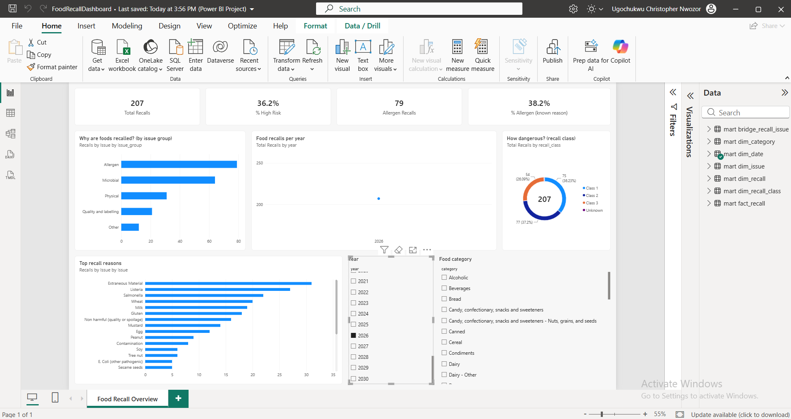
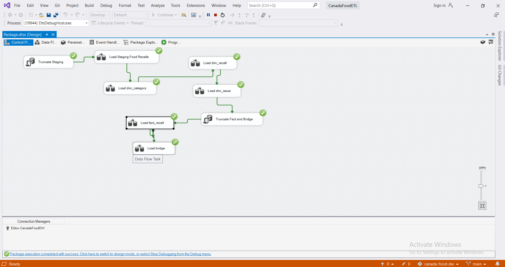
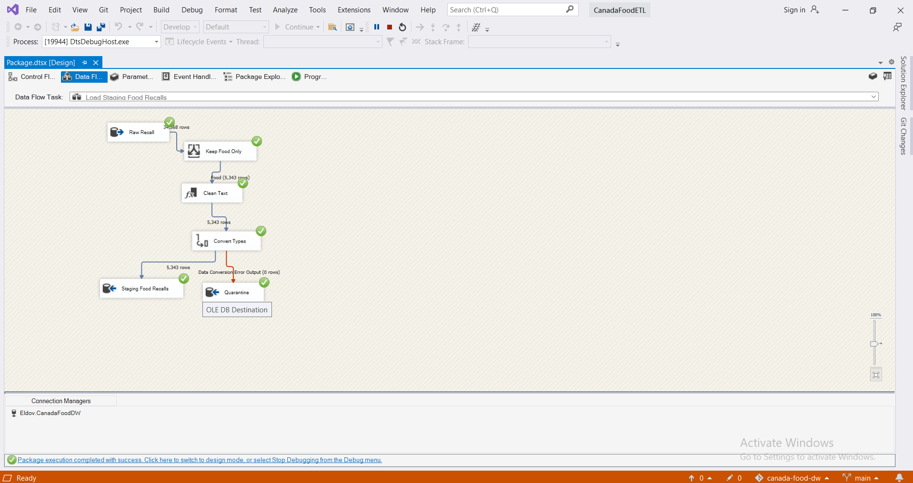
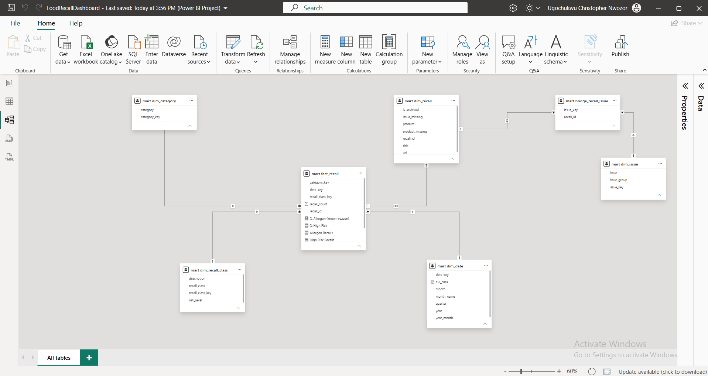
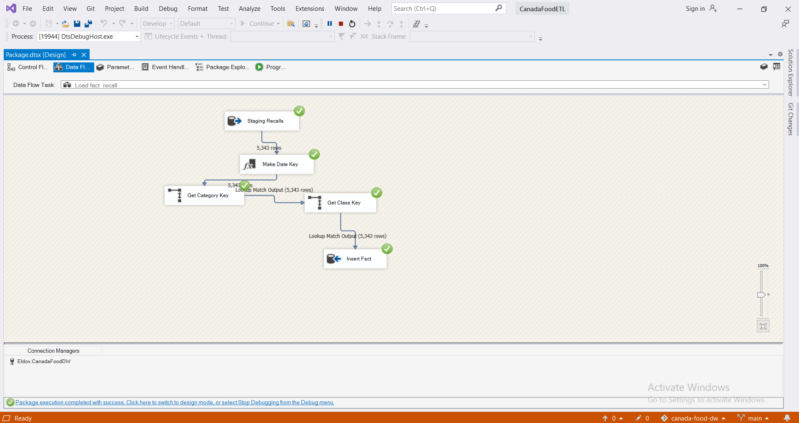

# Canadian Food Recall Data Warehouse

An end-to-end data warehouse built on **real Government of Canada open data**, using the Microsoft data stack: **SQL Server, SSIS, T-SQL and Power BI**.

**Business question:** *Which food categories get recalled most in Canada, and why?*

**Headline finding:** nearly **half of food recalls with a known cause (≈48%) are due to undeclared allergens**, with **milk** the single most common reason. About **37% of food recalls are Class 1** (high risk).



---

## Architecture

```
Government CSV (34,368 recalls, 1991–present)
        │  SSMS import (all columns as text)
        ▼
raw.recalls                       ← landed as-is, never edited
        │  SSIS: scope → clean → convert → quarantine bad rows
        ▼
staging.food_recalls (5,343)      ← CFIA food recalls, typed and cleaned
staging.food_recalls_quarantine   ← rows failing critical rules
        │  SSIS: Lookups for keys, views for multi-value split
        ▼
mart (star schema)                ← fact_recall + 5 dimensions + bridge
        │
        ▼
Power BI dashboard
```

The whole pipeline runs as **one SSIS package with 8 steps** and is **idempotent**: it can be rerun at any time without duplicating data.



**Staging data flow:** 34,368 raw rows → 5,343 food recalls cleaned and converted, 0 sent to quarantine.



## Data source

[Recalls and Safety Alerts](https://open.canada.ca/data/en/dataset/d38de914-c94c-429b-8ab1-8776c31643e3), Health Canada / Canadian Food Inspection Agency (CFIA). Contains information licensed under the **Open Government Licence – Canada**.

The file mixes every agency (food, vehicles, drugs, medical devices, consumer products). This project scopes the warehouse to **CFIA food recalls**.

## Data profiling and quality rules

Every column was profiled before any cleaning (`sql/profile_table.sql`: nulls, distinct values, lengths, sample values). Findings and the rule applied:

| Column | Finding | Rule |
| --- | --- | --- |
| Organization | Mixes agency codes (TC, CFIA, HC) with department names | Scope to CFIA |
| Recall class | Two scales (Class 1/2/3 and Type I/II/III), `--` junk, combined values | Standardise to Class 1/2/3; combined value keeps the most serious; junk → Unknown |
| Issue | 867 food recalls with no reason | "Unknown" + `issue_missing` flag |
| Issue | Several reasons in one cell (`Egg - Soy`) | Split into a bridge table |
| Issue | Some single reasons contain the separator (`E. Coli - non-pathogenic`) | Protected before splitting |
| Product | Empty for every food recall before 2021 (not recorded by the source system) | "Unknown" + `product_missing` flag, **not** quarantined |
| What you should do | 92% empty | Dropped |
| NID | Unique, always 5 digits | Business key, converted to INT |

**Two-level approach:** critical failures (invalid ID or date) go to a **quarantine** table through SSIS error outputs. Missing optional values are kept with a default and a flag. A strict "reject any null" rule would have discarded 90% of the food data.

## Star schema

| Table | Grain / content | Loaded by |
| --- | --- | --- |
| `fact_recall` | One row per recall: keys + `recall_count` | SSIS, Lookups to resolve surrogate keys |
| `dim_date` | One row per day, 1990–2030 | Script (reference dimension) |
| `dim_recall_class` | Class 1/2/3 + Unknown, with risk level | Script (reference dimension) |
| `dim_category` | 42 food categories | SSIS Lookup (insert new only) |
| `dim_recall` | Title, product, URL, flags | SSIS Lookup (insert new only) |
| `dim_issue` | 35 reasons grouped into Allergen, Microbial, Physical, Chemical... | SSIS Lookup (insert new only) |
| `bridge_recall_issue` | 5,573 recall-reason links | SSIS, from a SQL view that splits reasons |



**Fact load:** Lookups swap category and recall class text for their surrogate keys before insert.



Design choices: surrogate keys, an Unknown member (-1), conformed dimensions (`dim_date` can be shared with future marts), and a bridge table for the many-to-many recall–reason relationship.

## Idempotency and reconciliation

- Staging, fact and bridge: **truncate-then-load**.
- Dimensions: **Lookup on the business key**, inserting only new members, so surrogate keys stay stable.
- Row counts reconciled at every layer: 34,368 raw → 5,343 staging → 0 quarantined → 5,343 fact → 5,573 bridge.

## Repository layout

```
sql/                              T-SQL: profiling, staging tables, star schema, issue-split views
CanadaFoodETL/                    SSIS project (Package.dtsx)
canada-food-dw.SemanticModel/     Power BI model (TMDL): relationships and measures
canada-food-dw.Report/            Power BI report definition
FoodRecallDashboard.pbip          Open this in Power BI Desktop
source_files/                     The source CSV
```

## How to run

1. Create the database and raw table: import `source_files/HCRSAMOpenData.csv` into `CanadaFoodDW.raw.recalls` (all columns `nvarchar(MAX)`).
2. Run `sql/03_ssis_staging_tables.sql`, `sql/04_create_mart.sql` and `sql/05_issue_views.sql`.
3. Open `CanadaFoodETL/CanadaFoodETL.sln` in Visual Studio (SSIS extension) and run `Package.dtsx`.
4. Open `FoodRecallDashboard.pbip` in Power BI Desktop and refresh.

## Known limitations and next steps

- About 209 recalls from other agencies are also labelled "Food"; the mart defines food as CFIA only.
- Older recalls often lack a product or reason; these are flagged rather than hidden.
- Next: deploy to the SSIS Catalog and schedule with SQL Server Agent; handle changes to existing recalls with a Slowly Changing Dimension; migrate to Azure Data Factory and Azure SQL.

---

*Built by Christopher Nwozor.*
